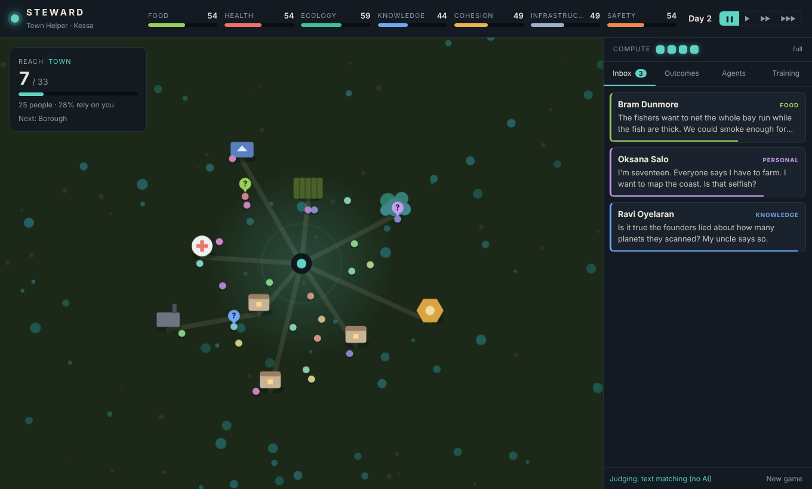

# Steward

A browser game where you are the AI a new world relies on.

You are the colony ship's assistant, rehoused in a mast at the centre of the only town on a new planet. Twenty-four people live there. They bring you questions, what you say changes what they do, and what they do changes the world. Help them well and more of them rely on you, the town grows, and you are trusted with more of it. Fail them and the world dies.



## Running it

You need [Node.js](https://nodejs.org) 22 or newer.

```bash
npm install
node server.js
```

Then open http://localhost:5173.

## How to play

- **Answer questions.** People with a `?` above them have a question. Click them, or the question in the inbox.
- **Two ways to reply.** A written reply costs 1 compute and lands at once. Typing your own costs half, takes 10 seconds to process, and only one can be in the works at a time.
- **Watch the seven measures.** Food, Health, Ecology, Knowledge, Cohesion, Infrastructure and Safety all wear down every day. If they collapse, so does the town.
- **Grow your reach.** Reach is population times the share of people who rely on you. It carries the settlement from Town to Borough, City, Metropolis and World-State.
- **Critical questions.** A red `!` will not wait long. Leave it unanswered and the world takes the damage, not just your reputation.
- **Crises.** Storms, floods, quakes, fever and wildfire arrive without warning and bring a rush of life-or-death questions. Some cut you off entirely until you repair the link by solving a puzzle, while the world keeps taking damage.
- **Council.** From Borough on, the council brings decisions that move everyone at once.
- **Sub-agents.** From City on, you can hand whole topics to sub-agents, each following a directive you choose. They are right most of the time and never touch critical questions.
- **Training.** Replies that turn out well earn insight. Spend it to know a topic better: stronger good outcomes, a warning on the riskiest written reply, softer failures.
- **The Ark.** At planetary reach, the assembly asks whether to build it. Launch it and you begin again on a harsher world.

The pleasing answer and the good answer are not always the same one.

### Keys

| Key | Action |
|---|---|
| Space | Pause or resume |
| 1, 2, 3 | Game speed (outside a dialog), or pick a written reply (inside one) |
| Enter | Send a typed reply |
| Esc | Close a dialog |

## Saved worlds

Each player's world is saved in their own browser: after every outcome, at the end of every day, every few seconds while playing, and when the tab is hidden or closed. Closing the tab and coming back later picks up where they left off.

The save belongs to that browser on that device. It does not follow a player to another device. It is lost if they clear their site data, and a private window starts fresh every time.

## Typed replies and the judge

Written replies always work the same way. For replies a player types, each player chooses what decides the outcome, under **Judging** at the bottom of the sidebar or **change** in any reply dialog:

| Option | Cost | How it judges |
|---|---|---|
| **Text matching** (default) | Free, no key | Matches the words to the closest written reply. Rough: it cannot tell "use poison" from "don't use poison". |
| **Free AI (Gemini)** | Free | Google's `gemini-3.5-flash-lite` on its free tier, with the player's own free key from [Google AI Studio](https://aistudio.google.com/apikey), or the game's shared key if the host has set one. |
| **Your own Claude key** | Paid by that player | Anthropic's Claude (Opus, Sonnet or Haiku), charged to the player's own Anthropic account. |

If the chosen judge fails (a bad key, a used-up allowance, no connection), that reply falls back to text matching and the player is told why.

**Keys.** A player's keys are kept in their own browser. They are sent only with that player's typed replies, to this game's server, which passes them to Google or Anthropic for that one request and does not store or log them.

**Costs to the host: none.** The server never uses a paid key of yours. The only key it can hold is an optional shared `GEMINI_API_KEY`. A Gemini key from a Google project with billing switched off cannot be charged; when the free allowance runs out, Google refuses requests instead. Each visitor may send 30 typed replies every 10 minutes through the shared key (`STEWARD_RATE_LIMIT` changes this), so one person cannot use up everyone's allowance. That limit is kept in memory on each server instance, so it is a speed bump, not a hard cap.

**Privacy.** On Google's free tier, what is sent to Gemini may be used to improve Google's products. The settings dialog tells players this.

To try the shared key locally, copy `.env.example` to `.env`, add `GEMINI_API_KEY`, and restart the server.

## Hosting on Vercel for free

The project runs on Vercel as it is: the game is served from `public/`, and `api/judge.js` and `api/status.js` run the judge.

1. Sign up at [vercel.com](https://vercel.com) on the free **Hobby** plan. It is for personal, non-commercial projects. Do not add a payment method.
2. Choose **Add New → Project** and import this GitHub repository.
3. Leave the framework preset as **Other**, with no build command.
4. Optional: under **Environment Variables**, add `GEMINI_API_KEY` so players get free AI judging without a key of their own. Use a key from a Google project with billing switched off.
5. Deploy. Every push to `main` deploys again.

With no environment variables at all, the site still works: players get text matching, or add their own key.

## Project layout

| File | What it holds |
|---|---|
| `server.js` | Local server: serves `public/` and the judge |
| `api/judge.js`, `api/status.js` | The same judge, as Vercel functions |
| `lib/judge.js` | The Gemini and Claude judges and the rate limit, shared by both |
| `public/index.html`, `public/style.css` | The page |
| `public/src/content.js` | Topics, stages, crises, training levels and the first set of questions |
| `public/src/content-more.js` | The wider question pool, critical questions and crisis questions |
| `public/src/game.js` | The simulation: people, questions, outcomes, crises, training, progression, saving |
| `public/src/render.js` | The map |
| `public/src/ui.js` | The interface and main loop |
| `public/src/puzzle.js` | The reconnection puzzles |
| `public/src/judge.js` | Text matching for typed replies (no AI) |
| `public/src/settings.js` | Each player's judging choice and keys |

To add a question, copy an entry in `public/src/content-more.js`. Each has a topic, a minimum stage, the question, and three replies with their outcome, effects and how they land in the moment.

## License

Copyright © 2026 Cedric Antony Joseph. All rights reserved. See [LICENSE](LICENSE).

This code is published so it can be read. It is not open source: you may not copy, modify, redistribute or sell it without written permission.
